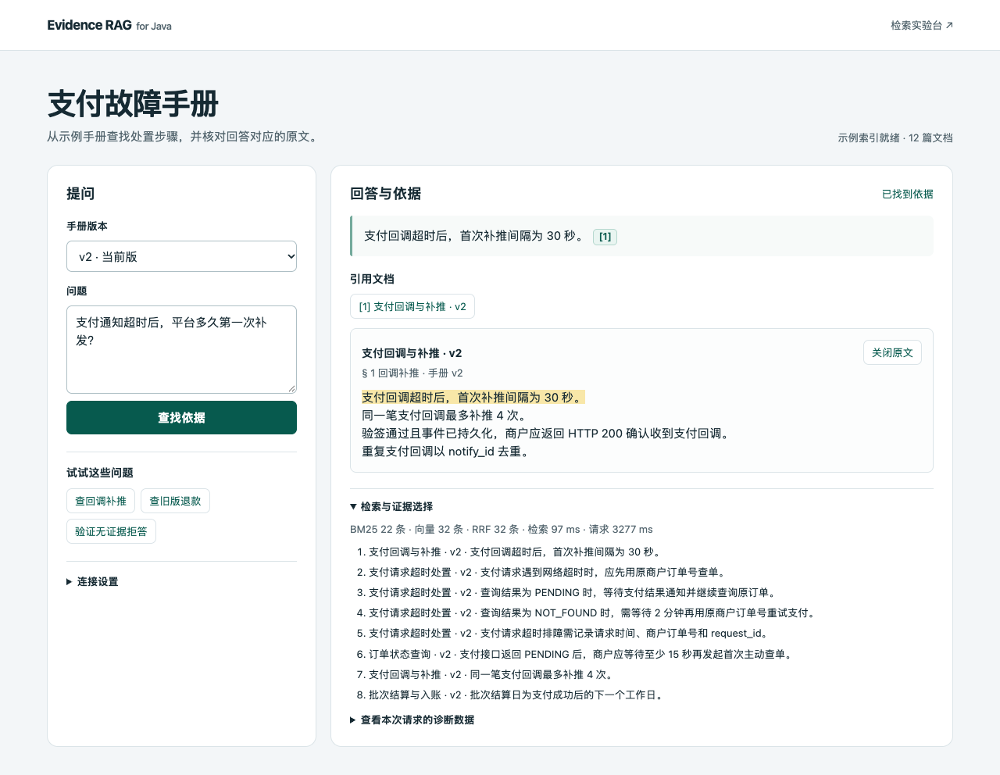
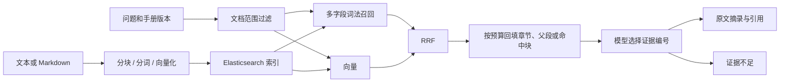

# rag4pro

一个可本地复跑的 Java 21 RAG 项目。以支付故障手册为示例，使用 Elasticsearch 做独立词法召回和向量召回，用 RRF 合并候选，再由模型选择支持答案的原文。可以从回答跳到原文、核对手册版本，也可以逐步查看召回与证据选择。

## 运行演示

在项目根目录的 `.env` 中配置 OpenAI 兼容网关。聊天和向量化分别读取 URL、模型 ID 和鉴权密钥，证据摘录默认用同一个聊天模型。已有 `.env` 可直接使用。[配置示例](.env.example)

```bash
docker compose up -d --build --wait
```

打开 <http://localhost:18080> 进入工作台。可以点示例问题建立支付手册索引，也可以新建知识库，上传 TXT、Markdown、带文字的 PDF 或 DOCX。后台入库完成后可查看分块、预览原件并直接提问。

- **对话**支持多轮追问、证据摘录和流式综合回答。新入库文档的引用可打开对应版本的原件，并定位到 PDF 页或 Word 正文段落与表格。
- **知识库**支持固定窗口、结构分块、父子分块和多层分块，可预览检索块、父段和章节窗口的数量。
- **检索实验**可在相同问题、文档范围、候选池和证据预算下，对照两组召回与上下文配置，查看共同命中、候选阶段及名次变化，并保存供复跑的配置。

操作步骤见[工作台使用指南](docs/workspace.md)。

<http://localhost:18080/demo> 保留专用的支付手册演示，可以直接试三种情况。

| 演示 | 看什么 |
|---|---|
| 查回调补推 | v2 返回首次补推 **30 秒**，点引用高亮手册原句 |
| 查旧版退款 | v1 返回 **5 个工作日**，切换到 v2 后按同一问题查到 **7 个工作日** |
| 验证无证据拒答 | 手册没有退款手续费条款，返回“资料不足，无法回答。” |

<http://localhost:18080/lab> 可查看原始 API 的候选、ES DSL 和模型上下文。示例手册、题目和运行结果均可以在本仓库查看。

在 Linux 上也可以运行 `./run.sh`。安装 Java 21、Maven、Node.js 22、Go 1.26.4+、`g++`、`libpcre2-dev`、`libsimde-dev` 和 Docker Compose，脚本启动 Elasticsearch 容器并在宿主机运行 Java。在 macOS 上，原生编译依赖 Xcode Command Line Tools 和 Homebrew 的 `pcre2`、`simde`。

切换向量模型后，使用新的 Compose 项目为该模型建立索引。服务默认监听本机回环端口，健康检查返回 Elasticsearch 索引、向量模型标识和聊天模型。



## 实现



- **范围控制。** 手册版本在召回前约束两路查询。索引、文档目录和原文使用可追踪的文档 ID。
- **引用校验。** 模型输出结构化证据编号，Java 校验编号并附上 UTF-16 起止位置。浏览器可以在原始手册里定位该片段。非法响应和上游不可用各有错误码。
- **诊断。** 区分候选里有没有证据、模型选的是什么、引用是否能回到原文。请求 ID 可在浏览器和服务端日志中对应。
- **工程机制。** 批量索引、目录原子落盘和失败补偿、请求体大小限制、并发准入、模型超时及有界重试。

## 评测与复现

- **分块与证据覆盖。** HotpotQA 的 100 道固定留出题使用 OPay 网关向量。完整支持句覆盖从固定窗口的 **44/100** 提高到多层索引的 **56/100**、父段回填的 **64/100**，加入文档多样性和章节回填后为 **66/100**。五组共用召回与证据预算上限。[HotpotQA 对照报告](docs/evaluation/rag4pro-retrieval.md)
- **公开检索集。** OPay 网关向量的 SciFact 对照覆盖 5,183 篇文献与 300 道官方测试题。独立词法与向量召回加 RRF 将 nDCG@10 从 **69.65% 提高到 73.65%**，Recall@10 从 **82.77% 提高到 87.91%**。[本次对照](docs/evaluation/rag4pro-retrieval.md#beir-scifact-文档排序) · [历史 SciFact 对照](docs/evaluation/scifact.md)
- **中文问答。** 36 道支付手册测试题的发布版复测中，完整引用 **23/24**，正确拒答 **12/12**，版本及引用校验 **36/36**。漏答子问题和前两轮的结果可逐题复查。[中文问答报告](docs/evaluation/payment.md)
- [评测命令](evaluation/README.md) · [核心链路导读](docs/reading-guide.md) · [API 与调试字段](docs/api.md)

```bash
python3 evaluation/payment_qa.py --labels evaluation/payment-qa-v2.json --split dev --out evaluation/runs/payment/dev
python3 evaluation/payment_qa.py --labels evaluation/payment-qa-v2.json --split test --dev-summary evaluation/runs/payment/dev/summary.json \
  --out evaluation/runs/payment/test
```

检索和回答指标均针对各自的评测集。合成手册用于演示与回归，语义验收以报告中的逐题结果为准。

## 代码来源与范围

文本索引和标准检索链路参考 InfiniFlow RAGFlow 的 Go 实现，固定在提交 `e4bd0801d5169c3dc0847ce0ea06fc6c3e516105`。独立召回与 RRF 实验、支付手册演示和评测脚本在此 Java 项目上实现。详见 [上游对齐范围](docs/alignment/coverage.md)、[原生分词器来源](native/UPSTREAM.md) 和 [NOTICE](NOTICE)。[RAGFlow 上游源码](https://github.com/infiniflow/ragflow/tree/e4bd0801d5169c3dc0847ce0ea06fc6c3e516105)

该演示支持单实例目录，面向本地运行。服务级令牌覆盖业务 API，多租户文档权限、集群容量和灾备属于另外的验收范围。

[Apache License 2.0](LICENSE)
