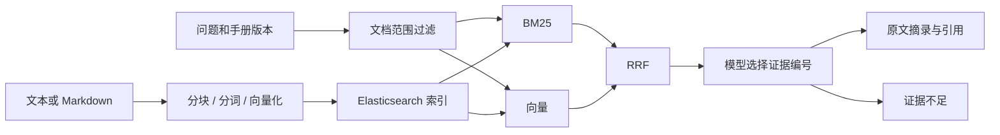

# Evidence RAG for Java

一个可本地复跑的 Java 21 RAG 项目。以支付故障手册为示例，使用 Elasticsearch 做独立词法召回和向量召回，用 RRF 合并候选，再由本地模型选择支持答案的原文。可以从回答跳到原文、核对手册版本，也可以逐步查看召回与证据选择。

## 运行演示

在运行中的 Ollama 上下载模型。Docker Desktop 可以从容器访问宿主机的 Ollama。

```bash
ollama pull bge-m3
ollama pull qwen3:4b
docker compose up -d --build --wait
```

打开 <http://localhost:18080>，建立示例索引。可以直接试三种情况。

| 演示 | 看什么 |
|---|---|
| 查回调补推 | v2 返回首次补推 **30 秒**，点引用高亮手册原句 |
| 查旧版退款 | v1 返回 **5 个工作日**，切换到 v2 后按同一问题查到 **7 个工作日** |
| 验证无证据拒答 | 手册没有退款手续费条款，返回“资料不足，无法回答。” |

<http://localhost:18080/lab> 是检索实验台，可以自行建索引、查看候选、ES DSL 和模型上下文。示例手册、题目和运行结果均可以在本仓库查看。

在 Linux 上也可以运行 `./run.sh`。安装 Java 21、Maven、Go 1.26.4+、`g++`、`libpcre2-dev`、`libsimde-dev` 和 Docker Compose，脚本启动 Elasticsearch 容器并在宿主机运行 Java。在 macOS 上，原生编译依赖 Xcode Command Line Tools 和 Homebrew 的 `pcre2`、`simde`。

若需换端口、模型或接 OpenAI 兼容嵌入服务，可按 [.env.example](.env.example) 配置。服务默认监听本机回环端口，健康检查验证 Java 能读取 Elasticsearch。首次索引和问答还需要相应的 Ollama 模型已安装。


## 实现



- **范围控制。** 手册版本在召回前约束两路查询。索引、文档目录和原文使用可追踪的文档 ID。
- **引用校验。** 模型输出结构化证据编号，Java 校验编号并附上 UTF-16 起止位置。浏览器可以在原始手册里定位该片段。非法响应和上游不可用各有错误码。
- **诊断。** 区分候选里有没有证据、模型选的是什么、引用是否能回到原文。请求 ID 可在浏览器和服务端日志中对应。
- **工程机制。** 批量索引、目录原子落盘和失败补偿、请求体大小限制、并发准入、模型超时及有界重试。

## 评测与复现

- **公开检索集。** 历史 SciFact 对照覆盖 5,183 篇文献与 300 道官方测试题。Java 默认路径切换到独立两路召回加 RRF 后，nDCG@10 从 **69.65% 到 73.71%**，Recall@10 从 **82.77% 到 87.91%**。报告保留逐题排名、退化案例和模型配置差异。[SciFact 对照报告](docs/evaluation/scifact.md)
- **中文问答。** 36 道支付手册测试题的发布版复测中，完整引用 **23/24**，正确拒答 **12/12**，版本及引用校验 **36/36**。漏答子问题和前两轮的结果可逐题复查。[中文问答报告](docs/evaluation/payment.md)
- [评测命令](evaluation/README.md) · [核心链路导读](docs/reading-guide.md) · [API 与调试字段](docs/api.md)

```bash
python3 evaluation/payment_qa.py --labels evaluation/payment-qa-v2.json --split dev --out evaluation/runs/payment/dev
python3 evaluation/payment_qa.py --labels evaluation/payment-qa-v2.json --split test --dev-summary evaluation/runs/payment/dev/summary.json \
  --out evaluation/runs/payment/test
```

检索和回答指标均针对各自的评测集。合成手册用于演示与回归，语义验收以报告中的逐题结果为准。

## 代码来源与范围

文本索引和标准检索链路参考 InfiniFlow RAGFlow 的 Go 实现，固定在提交 `e4bd0801d5169c3dc0847ce0ea06fc6c3e516105`。独立召回与 RRF 实验、支付手册演示和评测脚本在此 Java 项目上实现。详见 [上游对齐范围](docs/alignment/coverage.md)、[原生分词器来源](native/UPSTREAM.md) 和 [NOTICE](NOTICE)。[RAGFlow 上游源码](https://github.com/infiniflow/ragflow/tree/e4bd0801d5169c3dc0847ce0ea06fc6c3e516105)

该演示支持单实例目录，面向本地运行。服务级令牌覆盖业务 API，多租户文档权限、集群容量和灾备属于另外的验收范围。

[Apache License 2.0](LICENSE)
