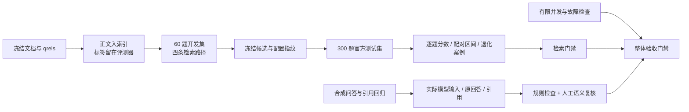

# 从代码理解测评闭环

先看 `evaluation/reports/2026-11-24/REPORT.md` 中的实测结果，再从对应阶段读代码。`evaluation/README.md` 给出可重跑命令和指标口径。

## 第一条主线：indexing 为什么影响检索

1. `CorpusService.index/indexBatch` 只接受文档，不接受 relevance 标签。`GeneralChunker` 负责正文切块；MD 文档先经过 MarkdownParser。
2. `IndexingPipeline.process` 生成粗/细粒度词法字段和标题字段，把正文向量与标题向量按默认 0.9/0.1 混合。分词 token 与模型 BPE 计数的 token 用途不同。
3. `IndexingPipeline.processBatch` 合并模型请求，限定缓存只活在本批内，之后仍调用同一个 process/embed 算法。测试比较单篇与批次的 token、ID、向量，防止“为了跑测评另写一条近似索引”。
4. `ElasticsearchStore.createBatch` 写 bulk，`DocumentCatalog.putNewBatch` 一次原子替换目录。目录失败时补偿清理 ES；崩溃恢复和跨进程事务仍需未来持久化作业支持。
5. 评测器校验文档集合、语料哈希、embedding identity 和完整目录，避免在只索引一部分语料时报告漂亮成绩。

## 第二条主线：retrieve 里究竟改了什么

`CorpusService.retrievalRequest → StandardRetrieval.retrieve` 先确定 dataset/doc/metadata 范围，再走策略。默认 `standard` 保留原版路径：词法表达式和 kNN 组合召回 → 仅零命中时回退 → 候选二次评分 → 阈值 → 分页 → 聚合。

新增 `strategy=lexical/dense/rrf` 是明确的实验和改进分支。lexical 不调用 embedding；dense 不附词法前置条件；RRF 以两路名次融合，不把词法覆盖率当作 BM25，也不把 ES score 当作 cosine。候选预算与字段范围写入配置和 trace。

测试首先确保这些算法差异实际体现在发往 ES 的请求中，而不只是不同模式名。`StandardRetrievalTest` 覆盖词法路径不碰模型、dense 不附 query_string、RRF 能接纳仅向量分支召回的候选，且保留数据集范围。

## 第三条主线：为什么命中文档仍可能答错

`CorpusService.answer → expandParents → enrichDocumentMetadata → ChatPipeline.complete/prepare → LocalChatModel.complete → CitationService.decorate`。

评测请求加 `evaluationTrace=true` 后，响应里的 `evaluation.modelBoundary.messages` 是这次真正发给模型的消息，包含最终引用指令和经过预算裁剪的证据；`prompt` 展示字段不能替代它。原始模型回答与引用补齐后的回答一起保留，避免把后处理补上的引用当成模型正确理解证据的证明。

`qa.py` 依次检查证据召回、进入最终上下文、事实正则、引用编号、预期证据引用。正则不能涵盖所有等价答案，也可能被同时含有正确和错误事实的答案骗过；最终语义正确性和忠实度必须单独复核。

本次小模型的 CEO 编造案例正说明这个边界：检索到了真实文档、输出也带引用，答案中的人名仍然没有证据。整体门禁保持阻断，比只输出一个“准确率”更有解释力。

## 读测评代码的顺序

`eval.py.prepare/verified_data → ingest → run → metrics → report_dir → select/gate`，之后看 `qa.py → load.py → release_gate.py → build_report.py`。

从 artifacts 中选一条改善和一条退化，手动对照 baseline/candidate 排名前十、qrels 与文本。面试时讲一个具体案例，比仅背总体提升数字更有说服力。
