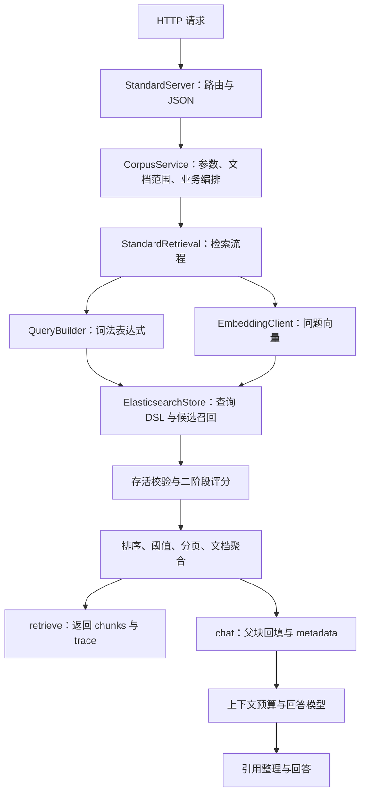

# 沿着标准 RAGFlow 数据流阅读 Java

第一次接触这类项目，先跟一条 `/api/retrieve` 请求走完：看它接收什么、调用谁、把什么返回给下一层。理解检索主线后，再向前补建索引、向后补回答。`Main` 用于查看依赖如何组装，不必一开始就展开其中的所有类。

## 第一遍：先认识这些词

| 词 | 在本项目中的含义 |
|---|---|
| dataset / 知识库 | 一组文档的检索范围，由 `datasetId` 指定 |
| document / 文档 | 用户上传的一篇文本；外部 `docId` 会转换为内部文档 ID |
| chunk / 块 | 文档切出来的一段，是检索候选的基本单位 |
| token | 需看用途：词法检索的词，或用于模型长度计数的 BPE 编码单元 |
| embedding / 向量化 | 将文本编码为数字数组；问题和文档必须使用匹配的模型和维度 |
| 词法检索 | 在标题、正文等字段中按查询词、短语及权重匹配 |
| kNN / 向量检索 | 按向量相似程度寻找候选；ANN 表示近似最近邻搜索 |
| recall / 召回 | 先收集一批可能相关的块，供后续评分选择 |
| rerank / 重排 | 对候选重新评分、排序；本项目默认使用内部评分，也可配置外部模型 |
| DSL | 发给 Elasticsearch 的 JSON 查询结构，trace 中可看到实际内容 |
| metadata | 文档的附加属性，可先限制文档范围，也可加入回答上下文 |

检索与问答共用前半条链路：



图中展示数据关系，实际方法调用顺序以下面的跟读表为准。

## 第二遍：跟着一条 retrieve 请求读

已有示例文档时，在页面点击检索，或发送：

```bash
curl -fsS http://localhost:18080/api/retrieve \
  -H 'Content-Type: application/json' \
  --data '{"datasetId":"demo-standard","question":"退款多久到账？","topK":5,"candidateK":64,"threshold":0.1}'
```

如果数据集为空，先在项目目录执行 README 中的建索引命令：`curl -fsS http://localhost:18080/api/documents -H 'Content-Type: application/json' --data-binary @samples/shop-policy.json`。页面支持直接读取 `.txt/.md` 文件；该 JSON 样例是 API 请求体。结果数量、分词和分数以实际返回为准，下面不预设固定值。

所有 Java 路径均相对 `src/main/java/ai/ragflow4j/`：

| 顺序 | 打开方法 | 只盯住这些输入和输出 |
|---|---|---|
| 1 | `StandardServer.handle` | `path` 命中 `/api/retrieve`，JSON 变为 `input`，交给 `corpus.retrieve` |
| 2 | `ragflow/CorpusService.retrieve` → `retrievalRequest` | 外部字段变成 `StandardRetrieval.Request`；检查 `question`、`docIds`、`pageSize`、权重与阈值 |
| 3 | `ragflow/StandardRetrieval.retrieve` | 这是检索流程总览；先记住 search、prune、score、sort、filter、page 的顺序 |
| 4 | `ragflow/QueryBuilder.question` | 问题文本变成 `QuestionResult`；看 `expression.matchingText`、`fields` 和 `keywords` |
| 5 | `ragflow/StandardRetrieval.search` → `searchEngine` | 文本表达式和问题向量送往引擎；向量具体由 `EmbeddingClient.embed` 产生 |
| 6 | `ragflow/ElasticsearchStore.search` | 看请求 `body` 的 `query`、`knn`、`filter`、`size`；返回 `Search.chunks` 与 ES 命中总数 |
| 7 | `ragflow/StandardRetrieval.prune` | 用目录中的存活文档集合清除过期候选，保留原版特殊文档规则 |
| 8 | `ragflow/StandardRetrieval.scoreSearchResult` | 看实际分支：模型重排、纯向量、ES 二次 kNN 取分，或异常后的本地评分 |
| 9 | `ragflow/Reranker.rerankWithKNN` | 默认成功分支：按候选 ID 对齐词法分、向量分，再融合并叠加排名特征 |
| 10 | 回到 `StandardRetrieval.retrieve` | 按最终分稳定降序，过滤阈值，再分页；`responseChunk` 组装对外字段 |

先把每一步当成一个函数盒子：记录“输入类型 → 输出类型”，确认数据确实流到了下一步，再展开盒子内部。第一次可跳过正则、BPE 合并、WordNet 文件解析以及 JSON 修复实现。

### 最容易混淆的参数

| HTTP 参数 | 内部字段 | 负责哪一层 |
|---|---|---|
| `topK` | `pageSize` | 最终每页最多返回多少块；直接检索默认 5，聊天默认 6 |
| `candidateK` | `rerankCandidatesCount` | ES 最多返回多少候选供二阶段评分；默认 64 |
| `knnTopK` | `knnTopK` | ES 向量查询的 k；默认 1024 |
| `knnNumCandidates` | `knnNumCandidates` | ES 近似向量搜索每个分片考察的候选范围；默认 2048 |
| `vectorWeight` | `vectorSimilarityWeight` | hybrid 的二阶段向量权重；默认 0.3，词法权重为 0.7 |
| `threshold` | `similarityThreshold` | 参与向量召回门槛及最终过滤，具体回退/模式有各自规则；检索默认 0.2，聊天默认 0.1 |

例如 `candidateK=64, topK=5` 表示最多取 64 个候选来评分，过阈值后返回当前页最多 5 个。候选不足或全部被过滤时，最终可以少于 5 个。页码和每页大小必须满足 `page × topK ≤ candidateK`。

`mode=bm25` 在当前接线中将最终向量权重设为 0；它并不意味着整个请求一定跳过 embedding 或 kNN。`mode=vector` 才会去掉首次召回中的词法表达式。理解运行行为时同时查看 `CorpusService.retrievalRequest` 和 `StandardRetrieval.search`，不要只根据模式名称判断。

### 字段是怎样一路传下来的

本项目大量使用 `Map<String, Object>`，用于保留上游字段名并对照 Go 实现。阅读 `put` 时看生产者，阅读 `get` 时找消费者；先追踪一个块的 ID 和正文就够了。

| 字段 | 产生/使用位置 | 阅读时的含义 |
|---|---|---|
| `id` / `_id` / `chunk_id` | 入库 / ES 命中 / 对外响应 | 同一块在不同阶段的标识写法 |
| `kb_id` | `CorpusService.materialize` → ES 过滤 | 块所属数据集，对应请求的 `datasetId` |
| `doc_id` | `DocumentCatalog.identity` → 文档过滤与聚合 | 内部文档 ID，和用户传入的外部 `docId` 不同 |
| `content_with_weight` | `materialize` → 上下文和引用 | 可阅读的正文；名称中的 weight 不表示这里保存的是评分 |
| `content_ltks` / `content_sm_ltks` | `IndexingPipeline.tokenize` → 词法召回/评分 | 正文粗、细粒度 token 字符串 |
| `title_tks` / `title_sm_tks` | `IndexingPipeline.tokenize` → 标题匹配 | 标题的粗、细粒度 token 字符串 |
| `q_<维度>_vec` | `IndexingPipeline.embed` → ES kNN | 标题与正文混合后的向量列，字段名随实际模型维度变化 |
| `_score` | ES 召回/二次取分 | 引擎分数，需结合请求分支理解 |
| `similarity` | `Reranker.Result.sim` → `responseChunk` | 最终排序分，可含排名特征，不是概率 |
| `term_similarity` / `vector_similarity` | `Reranker.Result.tsim/vsim` | 解释最终排序的两个分量；模型重排分支的后者是模型分 |
| `mom_id` / `available_int` | `materialize` → 父块回填/过滤 | 父块关联 / 可用性；隐藏父块通常为 0，常规检索块为 1 |

`Result.total` 是当前候选池中过阈值的块数，`chunks.size()` 是当前页返回数量，`docAggs` 按全部有效候选聚合。它们和 trace 里的 ES `total` 可能不同，都不能直接当成全库文档数。

### 怎样看 trace 和三个分数

正常 hybrid 路径常见 `initial → knn_scores → pagination`。首次召回零命中时，可能出现 `relaxed`、`dense_fallback`；二次 kNN 请求失败时出现 `local_rerank_fallback`。配置模型重排后出现 `rerank_model`，纯向量评分则为 `vector_only_scores`。提前返回空结果时，trace 可能没有 pagination 阶段。

普通融合关系为：`similarity = (1 - vectorWeight) × term_similarity + vectorWeight × vector_similarity + 排名特征贡献`。但本地评分遇到全部 cosine 为零时会直接使用词法分，纯向量分支也有独立处理，不能把一条公式套到所有分支。

调试空结果时，按数据流定位：先确认文档已入库和范围正确，再看 ES 是否召回，再看候选是否被存活校验或最终阈值清除。查得到但顺序不理想时，继续比较三组分数和实际评分分支。

## 第三遍：用断点和现有测试验证理解

最容易开始的是在 IDE 中运行 `src/test/java/ai/ragflow4j/ragflow/StandardRetrievalTest.java` 的 `zeroOnlyFallbackKeepsScopeAndExactFusionWeight`。它使用本地模拟 ES HTTP 服务和固定向量，不调用公司 embedding 或回答模型；仍需要已构建的原生分词器和资源。

按上面的顺序，在 `retrieve`、`searchEngine`、`ElasticsearchStore.search`、`scoreSearchResult`、`Reranker.rerankWithKNN` 放断点。依次记录问题表达式、请求 DSL、候选 ID、三个评分数组和最终 chunks。这个测试会走两次零命中回退，适合观察 trace 怎样增加。

再运行 `stablePaginationCountsAllThresholdValidCandidates` 理解分页与 total，运行 `knnFailureFallsBackToRawVectorsAndPrunesGhosts` 理解过期块清理和本地降级。测试名是行为说明，可以一项一项读断言。终端只运行该测试类的命令为：

```bash
JAVA_HOME=$(/usr/libexec/java_home -v 21) mvn -Dtest=StandardRetrievalTest test
```

页面或 curl 默认访问 Docker 中的 Java 服务；它不会触发 IDE 中另一个本地 JVM 的断点。先调试测试最直接，之后再在 IDE 启动 `Main`、设置所需环境变量及未占用的本地端口，并将 curl 指向该端口。

## 各层怎样配合

| 层 | 文件 | 它负责的事情 |
|---|---|---|
| 装配 | `Main` | 创建依赖并通过构造器传入；当前没有 Spring 容器 |
| HTTP | `StandardServer` | 路由、JSON、请求边界与错误响应 |
| 业务编排 | `CorpusService` | 把用户操作串成入库、检索和问答流程 |
| 检索编排 | `StandardRetrieval` | 召回、回退、候选清理、评分选择与结果整理 |
| 算法 | `QueryBuilder`、`TermWeightDealer`、`Reranker` 等 | 处理表达式、词权重与相似度计算 |
| 外部服务适配 | `ElasticsearchStore`、`EmbeddingClient`、`LocalChatModel` | 把内部调用转换为 ES/模型的 HTTP 请求 |
| 本地状态 | `DocumentCatalog`、`ContentVectorCache` | 文档存活信息、metadata 与可复用的正文向量 |

例如 `StandardRetrieval.Embedding` 是一个只要求“输入文本、输出向量”的接口；`CorpusService` 用 lambda 连接到真实 `EmbeddingClient`，测试则传入固定向量。因此读检索算法时可以暂时跳过网关重试实现。这也是把大流程拆成多个类后，仍能单独理解和验证每一段的原因。

下面再分别展开建索引、检索与回答的算法细节。

## 文档变成索引

```text
/api/documents
  → 文本 / Markdown 解析
  → GeneralChunker
  → IndexingPipeline
       → NativeTokenizer 粗分词与细分词
       → 正文 embedding
       → 原始文件名 embedding
       → 0.1 × 标题向量 + 0.9 × 正文向量
  → 未加权正文向量缓存
  → 内容 ID 与父块实体
  → Elasticsearch 写入
  → DocumentCatalog 文档存活目录
```

GeneralChunker 以 cl100k token 计数。普通文本按原始分隔符形成单元，再合并单元。当前块计数还没有超过阈值时可以继续追加一个完整单元，因此追加后可能超过目标。超过目标的独立单元整体保留。Markdown 使用另一套 projected-cap 合并和短标题关联行为。

overlapPercent 参与合并阈值，并在后处理阶段取前一块的 Unicode 字符尾部。它与旧版本按固定字符数切块的行为不同。`childrenDelimiters` 将已成形的父块再拆成子块，子块用于召回，父块用于补充回答上下文。

区分三种 tokenizer。

| 用途 | 实现 | 产物 |
|---|---|---|
| 分块和上下文预算 | Cl100k | token 数及裁剪边界 |
| 词法检索 | 原生 RAGAnalyzer | coarse/fine tokens、词频、词性 |
| Qwen embedding 输入窗口 | QwenBpe | 模型实际 BPE tokens |

RAGAnalyzer 使用与 Go 相同的 C++ 源码和词典，保留繁简转换、词典分词、WordNet 词形还原和 Snowball stemming。Java 通过 JNA 调用它。粗粒度与细粒度字段同时写入索引。

标题的词法字段会去掉文件扩展名，并可吸收文档内声明标题。标题 embedding 使用原始文件名。标题向量与正文向量直接线性混合，混合后保持原始数值。

## 问题变成检索结果

```text
/api/retrieve
  → QueryBuilder.Question
       → 清洗、语言分支、停用词处理
       → TermWeightDealer
       → 同义词及短语增强
       → 加权 query_string
  → ES Search
       → 数据集/文档/可用性过滤
       → 文本查询和 kNN
       → 空结果时按原版顺序放宽查询
  → PruneDeletedChunks
  → 二阶段评分
       → 配置模型时 RerankByModel
       → ES KNN 二次取分 + RerankWithKNN
       → KNN 失败时 RerankStandard
  → 稳定排序、阈值、分页、文档聚合
```

`QueryBuilder` 使用多个带权字段。标题、细粒度标题、关键词、问题、正文各自权重不同。索引 mapping 中 `*_tks` 使用 scripted similarity，`*_ltks` 使用词法检索字段的相似度配置。

`TermWeightDealer` 将词频 IDF、文档频率 IDF、实体类别和词性结合。`tokensToDict` 中单词贡献为 0.4，相邻词组合贡献为 0.6。`TokenSimilarity` 对查询侧权重做归一化，计算哪些查询词及相邻组合被候选覆盖。

常规二阶段融合保留 `tkWeight × termSimilarity + vtWeight × vectorSimilarity`，之后叠加标签和 PageRank 特征。具体分数来源取决于分支。ES 二次 kNN 分数沿用引擎 `_score`，本地 fallback 使用原始 cosine。两者的数值含义需要按实际分支看，页面 trace 会给出经过的阶段。

ES 首次召回的 fusion 配置和最终二阶段的 vectorWeight 是两个独立参数。当前基准的 ES fusion 第二权重固定为 1，不能把用户设置的最终向量权重直接套到首次召回。

## 检索结果变成回答

```text
/api/chat
  → 最近三个用户问题
  → 按配置多轮改写、跨语言转换、metadata 文档过滤、关键词增强
  → StandardRetrieval
  → expandParents
  → 文档 metadata
  → kbPrompt 知识块
  → 空知识回复分支
  → system prompt + 历史消息
  → messageFitIn
  → 本地模型
  → 修复引用格式、必要时 sentence–chunk cosine 补引
  → answer + reference + usage
```

聊天默认最终块数为 6，候选池为 64，kNN k 为 1024，向量权重为 0.3，相似度阈值为 0.1。多轮改写成功后使用完整问题，失败则保留原版问题序列处理。

父子块回填按数据集、文档和 mom_id 分组。父块内容替换子块内容，分数按命中的孩子求平均。这一操作发生在聊天消费检索结果时，直接检索接口仍返回子块。

知识块携带 `ID: n`、标题、URL、排序后的文档 metadata 和正文。`kbPrompt` 与 `messageFitIn` 分别使用原版 97% 和 95% 的预算处理。引用说明加入的时机和 completion 预算约束也按源码保留。

`[ID:n]` 指向当前知识块数组的下标。模型已给出引用时会修复和解析编号。模型没有引用时，按原版阈值下降规则比较回答句子和块向量，再生成 reference。父块缺少有效向量时沿用原版补引行为，结果可能只有 evidence reference。

## 对照入口

| Java | RAGFlow Go |
|---|---|
| GeneralChunker | internal/ingestion/component/chunker/general.go |
| IndexingPipeline | internal/ingestion/component/tokenizer.go |
| NativeTokenizer | internal/tokenizer/tokenizer.go 与 internal/binding/cpp/ |
| QueryBuilder / TermWeightDealer | internal/service/nlp/query_builder.go、term_weight.go |
| ElasticsearchStore | internal/engine/elasticsearch/chunk.go 与 conf/mapping.json |
| StandardRetrieval | internal/service/nlp/retrieval.go |
| Reranker | internal/service/nlp/reranker.go |
| QueryRefiner | internal/service/generator.go |
| ContextBuilder / ChatPipeline | internal/service/chat_pipeline.go |
| CitationService | internal/service/citation.go、chat_pipeline.go |

对照时先固定同一输入、同一配置、同一模型输出，比较 tokens、查询 DSL、候选 ID、三个分数、上下文和引用下标。LLM 输出本身有随机性，代码结构相同不能单独证明回答文本相同。

## 缓存与 metadata 的位置

chunker 在向量化之前生成内容 ID。正文缓存按原版长度前缀编码生成 xxhash key，并保存未混入标题的向量。缓存命中后仍重新合成标题权重，任务成功持久化后按 task manifest 清理，失败任务可在 TTL 内复用已有向量。

metadata 过滤先生成文档范围，再进入 chunk 检索。manual 无命中使用原版 -999 哨兵，auto/semi_auto 无法有效缩窄时保留原范围。比较运算和多值条件沿用源代码。模型输出的 JSON 修复调用同版本原依赖，以保留损坏 JSON 的处理语义。
